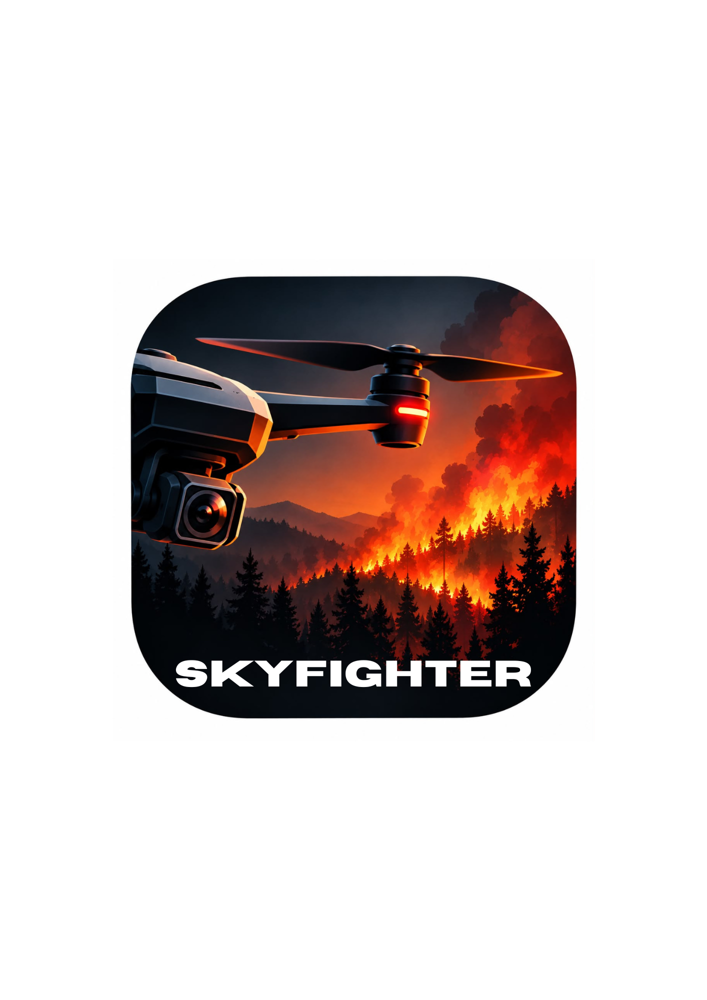

# SKYFIGHTER — Cross-Platform Forest Fire Detection UAV System
### Free-to-Distribute Ground Control Station (GCS), Edge AI & Dual-ESP32 Telemetry



**SKYFIGHTER** is an open-architecture, zero-paid-registration UAV ground control system engineered for rapid forest fire detection, dual-band thermal/RGB aerial surveillance, and tactical emergency alerts.

The project is designed to be **100% free to distribute and install** across:
- **iPhone & iPad** (Safari Progressive Web App / Free Personal Team Xcode Native Build)
- **Android Phones & Tablets** (Chrome Progressive Web App / Self-Signed APK)
- **Windows Laptops & Desktops** (Standalone Desktop App Launcher / Edge / Chrome)
- **macOS MacBooks & Desktops** (Native `.app` Bundle / Safari PWA / Swift Xcode)
- **Standard Web Browsers** (Any modern browser on Linux, ChromeOS, or desktop)

---

## 1. Subsystem Capability & Reality Audit

| Feature / Subsystem | Current State | Verification / Safety Guard |
| :--- | :--- | :--- |
| **PWA Web Ground Control Station** | **Fully Functional** | Responsive HUD, 10 tactical screens, offline service worker, touch joysticks. |
| **Environmental Telemetry (DHT11, MQ-2, Flame)** | **Fully Functional** | Live readings, baseline calibration, composite hazard engine (`sketch.ino` & `esp32_sensor_controller.ino`). |
| **Tactical GPS Telemetry (NEO-6M)** | **Fully Functional** | NMEA GGA parser, coordinate plotting, satellite count lock. Coordinates blocked until 3D fix valid. |
| **ESP32 #2 Communication Gateway** | **Fully Functional** | SoftAP (`SKYFIGHTER_GATEWAY`), WebSockets (port 8080), rate limiting (20 Hz), exclusive client leases. |
| **Dual-Band RGB + Thermal Cam AI** | **Simulated / Modular** | Canvas false-color LWIR pyrometry, multi-frame AI confirmation (`potential` -> `repeated` -> `human_verified`). |
| **Python 6-DOF Flight Simulator** | **Fully Functional** | Realistic quadcopter physics, geodetic WGS-84 drift, fire proximity heat/smoke dispersion, WebSocket server. |
| **Motor Mixing & ESC Flight Stabilization** | **SAFETY LOCKED OUT** | **Lockout Active**: `sketch.ino` is sensor-monitoring code, NOT certified flight control. Physical ESC pins are inactive. Manual controls operate in **Simulation Mode only**. |
| **3S LiPo Battery Voltage Telemetry** | **Hardware Unwired** | **Explicitly Reported as `null` / "UNAVAILABLE"**. Never fabricated or guessed. |

---

## 2. Zero-Paid-Registration Distribution Strategy

Traditional distribution models require $99/year Apple Developer fees or Google Play merchant registrations. SKYFIGHTER implements a **web-first, zero-cost distribution model**:

```
+---------------------------------------------------------------------------------+
|                       SKYFIGHTER Zero-Cost Distribution                         |
+---------------------------------------------------------------------------------+
         |                          |                           |
         v                          v                           v
+------------------+      +-------------------+       +-------------------+
|  iPhone & iPad   |      |      Android      |       |  Windows & macOS  |
|  Safari PWA      |      |  Chrome PWA / APK |       |  Desktop App /    |
|  Add to Home     |      |  Free Self-Signed |       |  Native .app      |
|  (No App Store)  |      |  (No Google Play) |       |  (No Notarization)|
+------------------+      +-------------------+       +-------------------+
```

### A. iPhone & iPad (Safari PWA)
1. Open the SKYFIGHTER URL in **Safari** on your iOS device.
2. Tap the **Share** button (box with upward arrow).
3. Tap **"Add to Home Screen"**.
4. Tap **Add**. SKYFIGHTER will launch full-screen as a standalone native-feeling app with offline support.
> *Note: iOS does not permit installing `.ipa` packages directly without developer signing. The native Swift source code is provided in `ios_source/` and can be installed via Xcode using a free Personal Apple ID.*

### B. Android (PWA or Direct APK Sideloading)
- **Method 1 (Instant PWA)**: Open in **Chrome** > Tap `⋮` menu > **"Install app"** or **"Add to Home screen"**.
- **Method 2 (APK Sideloading)**: Build or download the signed APK from `android/`, enable *"Install unknown apps"* in Android settings, and install directly.

### C. Windows (Desktop Launcher)
1. Extract `windows/SKYFIGHTER_Windows.zip`.
2. Double-click `launchers\Start-SKYFIGHTER.bat`.
3. Runs in standalone desktop window via Microsoft Edge / Chrome.

### D. macOS (Native App Bundle)
1. Extract `macos/SKYFIGHTER_macOS.zip`.
2. Move `SKYFIGHTER.app` to your Applications folder.
3. *First Launch Gatekeeper Notice*: Since the app is built without a paid $99/yr Apple certificate, right-click `SKYFIGHTER.app` and choose **Open**, or run:
   ```bash
   xattr -cr /Applications/SKYFIGHTER.app
   ```

---

## 3. Application Screen Guide

1. **Dashboard**: High-level tactical overview, live connection health, armed status pill, GPS fix status, quick telemetry cards, firmware capability lockouts, and composite hazard alerts.
2. **RGB Live Cam**: Video stream canvas with simulated forest canopy view, target crosshair, HUD pitch/heading tape, and AI bounding boxes (`FIRE: 0.94`, `SMOKE: 0.88`).
3. **Thermal Cam**: Long-Wave Infrared (LWIR) radiometric canvas with spot temperature pyrometry (Max Temp, Center Spot, Min Temp), hotspot tracker, and false-color palette selector (Ironbow, Inferno, Rainbow, White Hot).
4. **Fire Map**: Tactical vector map displaying drone heading cone, flight trail, pilot home base, and pulsing wildfire incident markers with GPS coordinates.
5. **Fire Alerts**: Real-time incident triage table, audible siren test, verification workflow (`potential` -> `repeated` -> `human_verified`), and JSON report export.
6. **Simulation Flight Controls**: Spring-loaded virtual cyclic joystick (roll & pitch), throttle safety slider with disarmed zero-lock, yaw turn steps, slide-to-arm security modal, and glowing red Emergency Motor Cut button.
7. **Sensor Diagnostics**: MPU6050 6-DoF accelerometer & gyroscope registers, DHT11 temp/humidity checksum validator, MQ-2 baseline delta auditor, and GPS NMEA sentence inspector.
8. **Connection Settings**: Gateway WebSocket URL configuration (`ws://192.168.4.1:8080/telemetry`), live vs simulation mode toggle, and single-client pilot control lease manager.
9. **Event History**: Timestamped mission audit log with search, filters (ALERT, COMMAND, SYSTEM, TELEMETRY), and CSV export.
10. **About & Install**: On-device guides for iPhone, Android, Windows, and Mac installation, system block diagrams, and safety notices.

---

## 4. Hardware Wiring & Pinout Guide

### ESP32 #1: Flight & Sensor Controller
- **DHT11 Temperature & Humidity**: GPIO 4
- **MQ-2 Smoke / Gas Sensor**: GPIO 34 (Analog ADC1)
- **Optical Flame Sensor**: GPIO 27 (Digital Input, Active-LOW)
- **MPU6050 6-DoF IMU**: I2C Bus (SDA: GPIO 21, SCL: GPIO 22, 3.3V)
- **NEO-6M GPS Module**: UART2 (RX: GPIO 16, TX: GPIO 17, 9600 Baud)
- **Local Alert Buzzer**: GPIO 26 (Digital Output, Active-HIGH)
- **ESC PWM Outputs**: GPIO 25, 33, 32, 18 *(Reserved, kept inactive in firmware)*
- **Serial Link to ESP32 #2**: Hardware UART Serial (115200 Baud)

### ESP32 #2: Communication & Wi-Fi Gateway
- **SoftAP Wi-Fi**: SSID `SKYFIGHTER_GATEWAY`, Password `password123`
- **Gateway IP**: `192.168.4.1`, WebSocket Port `8080`
- **UART Link to ESP32 #1**: RX: GPIO 16, TX: GPIO 17 (115200 Baud)
- **Status LED**: GPIO 2

---

## 5. Local Development & Building From Source

### Prerequisites
- Node.js 18+ (tested on Node v24)
- Python 3.8+ (tested on Python 3.10)
- Arduino IDE or PlatformIO (for ESP32 firmware)
- Xcode 15+ (for native macOS / iOS builds)

### A. Run Web GCS Locally
```bash
# Serve static dist/web directory
python3 -m http.server 8080 --directory dist/web
```
Open [http://localhost:8080](http://localhost:8080) in any browser.

### B. Run Python Flight Simulator & WebSocket Server
```bash
python3 simulation/server.py
```
This launches the WebSocket server on `ws://0.0.0.0:8080/telemetry` with realistic 6-DOF physics and fire scenario simulation.

### C. Run All Automated Test Suites
```bash
# 1. Swift Unit Tests (14 tests)
cd SkyfighterApp && swift test && cd ..

# 2. Shared Protocol JS Tests (11 tests)
node shared/protocol/test_protocol.js

# 3. Python Protocol Tests (5 tests)
python3 shared/protocol/test_protocol.py

# 4. Python Flight Simulation Tests (5 tests)
python3 simulation/test_flight_sim.py

# 5. Modular Edge AI Tests (4 tests)
python3 ai/test_ai_detector.py
```
**Total: 39 automated tests across Swift, JavaScript, and Python — 100% Passing.**

---

## 6. Connecting to Drone Hardware & Troubleshooting

1. **Power up drone hardware** (ESP32 #1 and ESP32 #2).
2. **Connect Ground Station Wi-Fi**:
   - Join SSID: `SKYFIGHTER_GATEWAY`
   - Password: `password123`
3. **Open SKYFIGHTER GCS**:
   - Navigate to **Connection** screen.
   - Select **Live Gateway** mode.
   - Verify WebSocket URL: `ws://192.168.4.1:8080/telemetry`.
   - Click **Connect to Gateway**.
4. **Troubleshooting**:
   - *Cannot connect to WebSocket*: Verify your laptop/phone is connected to `SKYFIGHTER_GATEWAY` Wi-Fi and not a home router. Ping `192.168.4.1`.
   - *Browser blocks local connection*: In hosted HTTPS deployments, modern browsers block insecure `ws://` connections. When operating in the field, open SKYFIGHTER via `http://` or install as a PWA / desktop app.
   - *GPS reads "NO GPS FIX"*: Move GPS antenna outdoors with clear sky view. The app deliberately will not fabricate coordinates without a valid 3D fix.

---

## 7. Safety & Aviation Notice

> [!WARNING]
> This ground control station is intended for experimental wildfire detection research. Motor commands and arming actions in the current release are confined to **Simulation Mode**. Physical flight stabilization, PID tuning, and autonomous emergency descent must be implemented and safety-certified directly onboard the flight controller before physical motors are attached.
